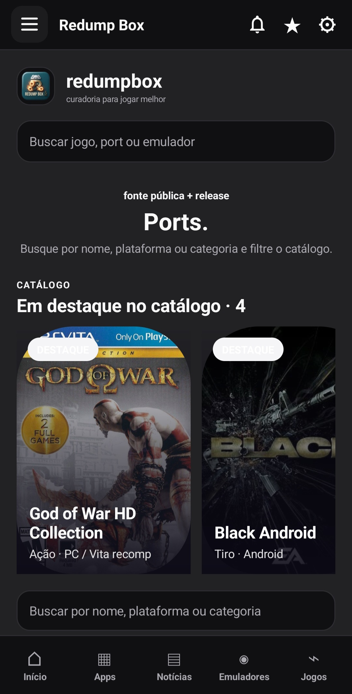
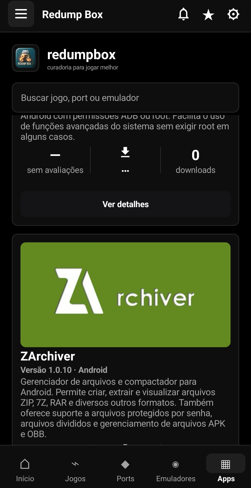

  

# Redump Box 1.0

  
  

O Redump Box é um app para Android que reúne ports, jogos e emuladores num só lugar. Em cada item você encontra capa, descrição, requisitos, versões e fotos, e pode navegar pelo catálogo do jeito que preferir.

  
  &nbsp;
  

## Requisitos

- Android 7.0 ou superior.
- Conexão com a internet para carregar o catálogo e as fotos. Sem internet, o app mostra o que já foi carregado antes.
- Espaço livre no aparelho para o app e para as capas e fotos guardadas no cache.
- Para rodar jogos, verifique os requisitos de cada item na ficha: eles informam a versão mínima do Android e o que o aparelho precisa.

## Ports Redump

A aba de ports traz o catálogo de jogos Redump. Cada item mostra capa, nome, categoria e plataforma.

- **Ordem:** A–Z ou Recentes. A escolha fica salva.
- **Visualização:** grade, agrupada por letra, ou lista, com um jogo por linha. Na grade, uma setinha indica quando há mais jogos naquela letra.
- **Ficha:** capa, descrição, requisitos, versões disponíveis e fotos do app.
- **Link do jogo:** quando existe, o botão "Abrir link do jogo" abre a página no navegador.
- **Data recompilada:** mostra quando a versão atual foi preparada.
- **Pedir link:** quem está logado pode pedir o link de um jogo que ainda não tem. Esse botão só aparece para contas logadas.
- **Contagem de downloads:** cada jogo mostra quantas contas já baixaram. Cada conta conta uma vez por jogo.

## Jogos originais

A aba Originais reúne jogos que não fazem parte do catálogo Redump. Eles têm a mesma ordem, a mesma visualização e a mesma ficha dos ports.

## Emuladores

A aba de emuladores lista cada emulador com os sistemas que ele roda, a plataforma, as versões e as fotos. Os emuladores em destaque aparecem numa vitrine no topo da aba, com imagens maiores.

## Apps auxiliares

A aba Apps reúne programas de apoio, como gerenciadores de arquivos, com versão, descrição e tamanho. Você pode ordenar por A–Z ou por Recentes.

## Início, coleções e novidades

- **Destaques:** jogos, emuladores e coleções em destaque na tela inicial. Tocar em um destaque leva direto ao item.
- **Coleções:** grupos de itens reunidos por tema, com capas de amostra e a quantidade de itens. A opção "Ver tudo" mostra todas as coleções.
- **Chegou agora:** os jogos e emuladores das últimas 24 horas. Quando não há nada novo, a faixa não aparece.
- **Notícias:** avisos com a data de publicação.

## Fotos

Jogos e emuladores podem ter fotos do app, em formato deitado, lado a lado. Quando há mais fotos do que cabe na tela, uma setinha indica que dá para rolar. Quando um item não tem fotos, aparece "Prévia indisponível".

## Temas

O app tem tema claro, tema escuro e a opção de seguir o tema do celular. Quando o celular muda entre claro e escuro, o app acompanha a mudança.

## Uso sem internet

O app guarda o último catálogo carregado. Sem internet, você continua vendo os jogos, emuladores, capas, descrições e fotos que já tinham sido carregados. Para ver novidades e abrir links, é preciso estar conectado.

## Aviso

O Redump Box não traz nenhum jogo ou emulador. Use apenas conteúdo que você tem autorização para usar.
