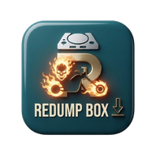

# REDUMP BOX

### Jogos, ports e emuladores reunidos no Android

[**Baixar Redump Box 1.0**](https://github.com/will-tool/Redump-Box/releases/download/1.0/redumpbox_beta_1.0_arm64.apk) · [Todas as versões](https://github.com/will-tool/Redump-Box/releases)

---

## Sobre

O Redump Box é um aplicativo Android com um catálogo de jogos, ports, emuladores e aplicativos. Cada item pode trazer informações, imagens e links relacionados. O conteúdo disponível pode mudar conforme as atualizações do catálogo.

## O que você encontra

- Catálogos separados para ports, jogos, emuladores e apps.
- Busca e filtros para encontrar itens por nome e categoria.
- Páginas de detalhes com informações e links disponíveis.
- Favoritos e histórico de downloads no dispositivo.
- Avisos sobre novidades e atualizações.
- Temas Mar, Escuro e Claro.

## Instalação

1. Baixe o APK na seção [Releases](https://github.com/will-tool/Redump-Box/releases).
2. Abra o arquivo no Android.
3. Se o Android pedir autorização para instalar apps obtidos pelo navegador ou gerenciador de arquivos, permita para essa origem e retome a instalação.

O pacote publicado nesta versão é para dispositivos **ARM64**. Se o Android informar que o pacote não é compatível, confira a arquitetura do aparelho.

## Atualizações

As novas versões são publicadas em [Releases](https://github.com/will-tool/Redump-Box/releases). Quando uma versão obrigatória estiver ativa, o app exibirá o aviso de atualização. A instalação do APK ainda requer a confirmação apresentada pelo Android.

## Capturas de tela

As imagens do app serão adicionadas aqui.

<!-- Depois de enviar capturas ao repositório, substitua este comentário por linhas como:

-->

## Comunidade

Telegram: [t.me/redumpbox](https://t.me/redumpbox)

## Observações

- O Redump Box é distribuído como APK para Android. Este repositório serve para apresentar o app e disponibilizar as versões; o código-fonte não está incluído.
- Verifique a origem e as informações de cada arquivo antes de instalar. Só baixe ou compartilhe conteúdo que você tem autorização para usar.
- O nome, as imagens e os arquivos de terceiros exibidos no catálogo podem pertencer aos respectivos titulares. O Redump Box não representa os titulares desses conteúdos.
- A instalação fora de uma loja oficial é uma escolha do usuário. Confira o arquivo e a versão antes de instalar.

---

**Redump Box · Android**

